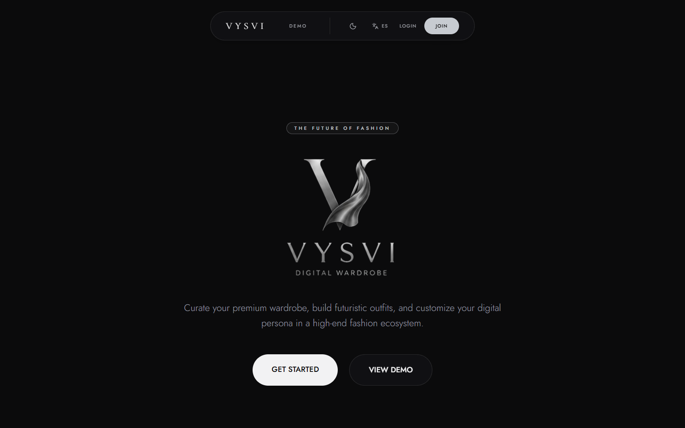
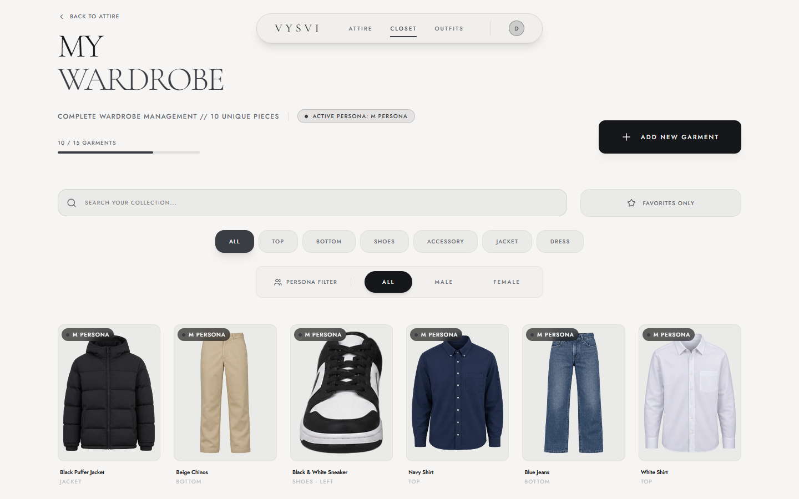
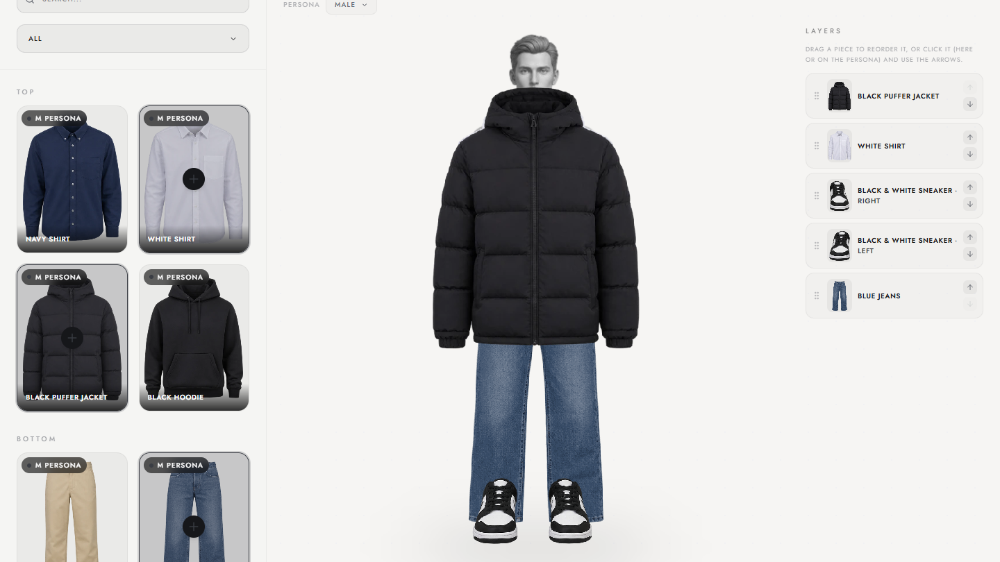
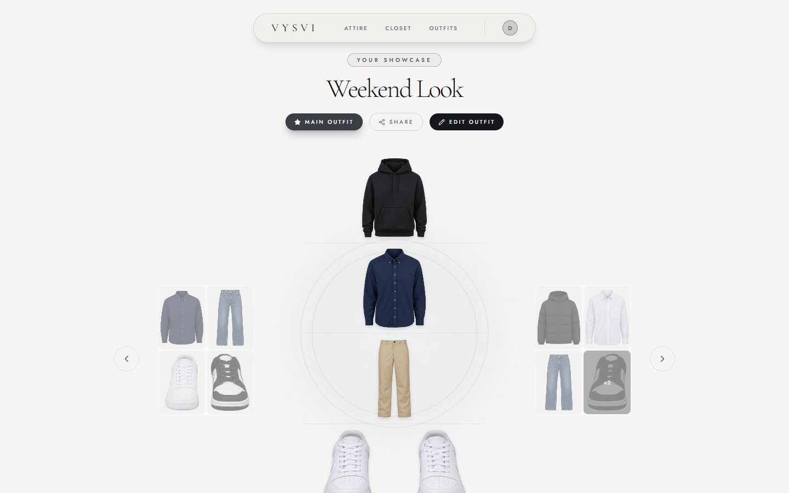

# VYSVI - Digital Wardrobe

VYSVI is a web app for building outfits from your own clothes. You add photos of your garments, the app removes the background,
and you combine them into outfits, either as a flat layout or layered on a 2D mannequin (the **persona**).

**Live site:** https://vysvi-web.onrender.com - try the [demo](https://vysvi-web.onrender.com/demo) without an account.



> The garments in these screenshots and in the demo are illustrative renders made for this project, with no brands. They are not
> photos of real clothing.

## What it does

- **Closet.** Upload a garment photo; the background is removed in your browser. Browse by category, search, mark favorites.
- **Outfit builder.** Pick a top, bottom, jacket and shoes. Shoes are one per foot, so a left and a right from different pairs can be mixed.
- **Persona.** See the outfit layered on a male or female mannequin and change the layer order.
- **Showcase and main outfit.** Flip through your saved outfits and pin a favorite as your main outfit.
- **Sharing.** Share an outfit as an image or a public link that you can turn off.
- **English and Spanish.** Switch the language from the navbar, the footer or the account menu.
- **Accounts.** Email and password or Google sign-in, password reset by email, and account deletion from Settings.

| Closet | Persona |
|---|---|
|  |  |



## Tech stack

- **Frontend:** React 19, TypeScript, Vite, Tailwind CSS, Zustand, Fabric.js (garment editors), Framer Motion. Background removal
  runs in the browser.
- **Backend:** Java 21, Spring Boot 3.3, Spring Security with JWT, JPA, Flyway migrations.
- **Data and services:** PostgreSQL (Supabase in production), Cloudinary for images, email through a small Google Apps Script relay.
- **Optional:** `backend-ai/`, a FastAPI + rembg background-removal service. It is not deployed.
- **Tests and CI:** Vitest, Playwright end-to-end tests, JUnit + MockMvc, pytest, and a Docker build with a smoke test on every push
  (GitHub Actions).

## Running it locally

You need Java 21, Node.js and a local PostgreSQL.

```bash
# backend - http://localhost:8080
cd backend
cp src/main/resources/application-local.properties.example src/main/resources/application-local.properties
# fill in the values described in that file (it is gitignored), then:
./mvnw spring-boot:run

# frontend - http://localhost:5173 (calls the API through Vite's proxy)
cd frontend
npm install
npm run dev
```

The database schema is created by Flyway on the first run. Tests: `./mvnw test` in `backend/`; `npm test` and `npm run e2e` in
`frontend/`.

## Deployment

The live site runs on Render (the API and the static website) with PostgreSQL on Supabase. A single-machine `docker compose` setup
also exists. See [DEPLOYMENT.md](DEPLOYMENT.md).

## Project structure

See [PROJECT_STRUCTURE.md](PROJECT_STRUCTURE.md) for a map of the code, the API, the database and how the main features work.
